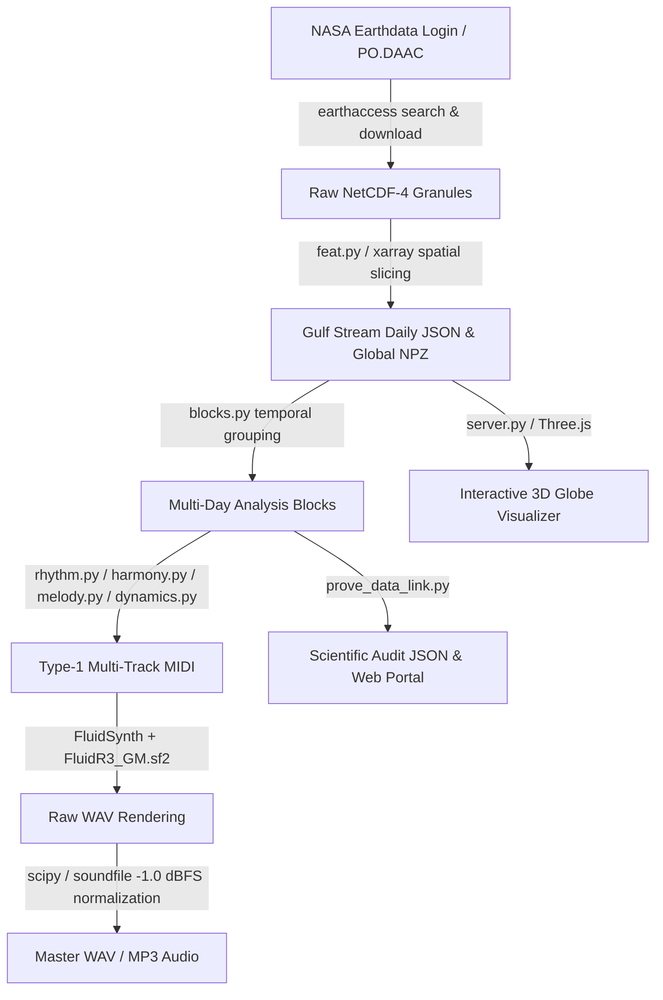

# AetherWaves: Scientific Ocean Data, SVS Visuals, & Sonification Pipeline Specification

This document provides a comprehensive scientific and technical reference for the datasets, visual models, algorithmic mapping systems, and complete processing pipelines implemented in the **AetherWaves** project.

---

## 1. Scientific Data Sources

AetherWaves integrates two complementary scientific data streams:
1. **Quantitative Observational Satellite Oceanography**: Daily ocean surface velocity fields from the NASA PO.DAAC OSCAR program.
2. **Numerical Simulation & Visual Flow Dynamics**: Global ocean circulation model visualizations from NASA Scientific Visualization Studio (SVS Entry 3912 / ECCO2).

```
                      ┌────────────────────────────────────────┐
                      │           NASA Scientific Data         │
                      └───────────────────┬────────────────────┘
                                          │
                  ┌───────────────────────┴───────────────────────┐
                  ▼                                               ▼
     ┌────────────────────────┐                     ┌────────────────────────┐
     │  NASA PO.DAAC OSCAR    │                     │   NASA SVS-3912        │
     │  (L4 Surface Currents) │                     │   (Perpetual Ocean /   │
     │  Daily satellite data  │                     │    ECCO2 Simulation)   │
     └────────────┬───────────┘                     └────────────┬───────────┘
                  │                                               │
                  ▼                                               ▼
     ┌────────────────────────┐                     ┌────────────────────────┐
     │ Quantitative Features  │                     │ 3D Visual Flow Texture │
     │ (u, v, ug, vg, ageo)   │                     │ (Three.js GPU Render)  │
     └────────────┬───────────┘                     └────────────┬───────────┘
                  │                                               │
                  └───────────────────────┬───────────────────────┘
                                          ▼
                             ┌────────────────────────┐
                             │ AetherWaves 5 Systems  │
                             │  (Data to Music Engine)│
                             └────────────┬───────────┘
                                          ▼
                             ┌────────────────────────┐
                             │ FluidSynth + Web Audio │
                             │ (.mid, .wav, .mp3, UI) │
                             └────────────────────────┘
```

---

## 2. Ocean Current Dataset: NASA OSCAR V2.0

### 2.1 Dataset Identity & Citations
- **Short Name**: `OSCAR_L4_OC_FINAL_V2.0`
- **Full Title**: Ocean Surface Current Analysis Real-time (OSCAR) Level 4 Ocean Currents Final Version 2.0
- **Data Provider**: NASA Physical Oceanography Distributed Active Archive Center (PO.DAAC) / Jet Propulsion Laboratory (JPL)
- **Digital Object Identifier (DOI)**: [10.5067/OSCAR-25F20](https://doi.org/10.5067/OSCAR-25F20)
- **Landing Page / PO.DAAC Catalog**: [https://podaac.jpl.nasa.gov/dataset/OSCAR_L4_OC_FINAL_V2.0](https://podaac.jpl.nasa.gov/dataset/OSCAR_L4_OC_FINAL_V2.0)
- **Earthdata Search Portal**: [https://search.earthdata.nasa.gov/search/granules?p=C2247167448-PODAAC](https://search.earthdata.nasa.gov/search/granules?p=C2247167448-PODAAC)
- **Direct Cloud Archive**: `https://archive.podaac.earthdata.nasa.gov/podaac-ops-cumulus-protected/OSCAR_L4_OC_FINAL_V2.0/`

### 2.2 Instrument & Measurement Principles
OSCAR calculates surface currents in the top 30 meters of the global ocean by combining:
1. **Sea Surface Height (SSH) Altimetry**: Derived from multi-mission radar altimeters (TOPEX/Poseidon, Jason-1/2/3, Sentinel-6 Michael Freilich, Sentinel-3A/B) yielding geostrophic velocity $(u_g, v_g)$ via the geostrophic balance:
   $$u_g = -\frac{g}{f}\frac{\partial \eta}{\partial y}, \quad v_g = \frac{g}{f}\frac{\partial \eta}{\partial x}$$
   where $g$ is gravity, $f$ is the Coriolis parameter ($2\Omega\sin\phi$), and $\eta$ is sea surface dynamic topography.
2. **Surface Wind Stress Vector Fields**: Derived from scatterometers and reanalysis models driving the ageostrophic Ekman layer component.
3. **Sea Surface Temperature (SST) Radiometry**: Thermal wind adjustments from satellite infrared and microwave radiometers.

### 2.3 Grid & Temporal Parameters
- **Spatial Resolution**: $0.25^\circ \times 0.25^\circ$ rectilinear global grid ($1440 \times 720$ longitude/latitude bins).
- **Temporal Resolution**: Daily intervals (1 temporal slice per 24-hour UTC window).
- **Time Periods Ingested in AetherWaves**:
  - Full Years: 2021, 2022, 2023, 2024, 2025.
  - Multi-Year / Calendar Months: 61 distinct calendar months (2021-01 through 2026-01).

### 2.4 Focus Target Region: Gulf Stream / North Atlantic
- **Region Name**: North Atlantic Current & Gulf Stream Separation Zone
- **Bounding Box**:
  - Latitude: $30.0^\circ\text{N} \le \text{lat} \le 40.0^\circ\text{N}$
  - Longitude: $280.0^\circ\text{E} \le \text{lon} \le 300.0^\circ\text{E}$ ($80.0^\circ\text{W} \le \text{lon} \le 60.0^\circ\text{W}$)
- **Oceanographic Dynamics**: A globally prominent energetic boundary current characterized by high kinetic energy, meanders, warm-core and cold-core rings, and strong wind-driven ageostrophic forcing.

### 2.5 Extracted Physical Variables
For each grid cell and day in the target region:
| Variable Name | Unit | Physical Meaning |
|---|---|---|
| `u` | $\text{m/s}$ | Total zonal (east-west) surface velocity component ($+ = \text{East}$) |
| `v` | $\text{m/s}$ | Total meridional (north-south) surface velocity component ($+ = \text{North}$) |
| `ug` | $\text{m/s}$ | Geostrophic zonal velocity from altimetry |
| `vg` | $\text{m/s}$ | Geostrophic meridional velocity from altimetry |
| `speed` | $\text{m/s}$ | Magnitude of velocity: $\sqrt{u^2 + v^2}$ |
| `speed_p95` | $\text{m/s}$ | 95th percentile regional speed (tames sensor spikes while capturing jet intensity) |
| `eu` (`ageo_u`) | $\text{m/s}$ | Ageostrophic zonal velocity: $u - u_g$ |
| `ev` (`ageo_v`) | $\text{m/s}$ | Ageostrophic meridional velocity: $v - v_g$ |
| `ageo_magnitude` | $\text{m/s}$ | Magnitude of ageostrophic flow: $\sqrt{(u - u_g)^2 + (v - v_g)^2}$ |
| `ageo_angle_deg` | Degrees ($^\circ$) | Direction of ageostrophic flow: $\text{atan2}(v - v_g, u - u_g) \times \frac{180}{\pi}$ |

---

## 3. NASA SVS Visualization: SVS-3912 & ECCO2 Model

### 3.1 Dataset Identity & Citations
- **Title**: NASA Scientific Visualization Studio (SVS) Entry 3912: *"Perpetual Ocean"*
- **Catalog Link**: [https://svs.gsfc.nasa.gov/3912/](https://svs.gsfc.nasa.gov/3912/)
- **Underlying Numerical Model**: ECCO2 (Estimating the Circulation and Climate of the Ocean, Phase II)
- **Model Project Portal**: [https://ecco.jpl.nasa.gov/](https://ecco.jpl.nasa.gov/)
- **Visual Production**: NASA Goddard Space Flight Center (GSFC) Scientific Visualization Studio & Horace Mitchell / NASA JPL

### 3.2 Scientific Background of ECCO2
- **Model Physics**: A state-of-the-art configuration of the MIT General Circulation Model (MITgcm) synthesized with global ocean observations (satellite altimetry, drifters, ARGO profiling floats, SST).
- **Resolution**: High-resolution global grid (~$1/4^\circ$ down to eddy-permitting $1/12^\circ$ horizontal grid cap).
- **Timeframe Represented**: June 2005 through December 2007 (baseline run).
- **Visualization Artifact in Project**:
  - `ecco2_sst_flow.mp4` / `web/ecco2_sst_flow.mp4`: High-resolution temporal sequence visualizing ocean flow streamlines color-coded by sea surface temperature.
  - In AetherWaves, this video is mapped dynamically onto an interactive 3D WebGL sphere via Three.js `VideoTexture`, allowing the user to click anywhere on the globe and trigger instantaneous coordinate sonification.

---

## 4. The 5-System Architecture & Musical Mapping

AetherWaves translates real data into acoustic parameters through 5 strictly ruled, deterministic systems.

```
┌────────────────────────────────────────────────────────────────────────┐
│                          AETHERWAVES 5 SYSTEMS                         │
├──────────────┬───────────────────────────────┬─────────────────────────┤
│ System       │ Input NASA Feature            │ Musical Output          │
├──────────────┼───────────────────────────────┼─────────────────────────┤
│ 1. Rhythm    │ speed_p95 (normalized)        │ Kick, snare, shaker     │
│              │                               │ tiers & fills           │
├──────────────┼───────────────────────────────┼─────────────────────────┤
│ 2. Harmony   │ Ageostrophic angle & mag      │ Chords (i, VI, iv, VII) │
│    & Bass    │ 7-bar trend                   │ Cello root & approach   │
├──────────────┼───────────────────────────────┼─────────────────────────┤
│ 3. Melody    │ speed_p95 & chord tones       │ French Horn / Strings   │
│              │ Voice leading (<= 4 semitones)│ MIDI 52-67              │
├──────────────┼───────────────────────────────┼─────────────────────────┤
│ 4. Dynamics  │ 3-bar centered moving average │ Velocity scaling 0.7-1.0│
│              │ Top 5% speed run starts       │ Crash & Riser accents   │
├──────────────┼───────────────────────────────┼─────────────────────────┤
│ 5. Form &    │ Period mean speed_p95         │ Key offset k (0..6 st)  │
│    Tuning    │ SHA256 period hash            │ Deterministic seed      │
│              │ Bar count                     │ 5 Section proportions   │
└──────────────┴───────────────────────────────┴─────────────────────────┘
```

### System 1: Rhythm (Groove & Density)
- **Input**: Block normalized `speed_p95` (scaled 5th to 95th percentile, clamped $0.0 - 1.0$).
- **Rules**:
  - Low Tier ($< 0.35$): Soft Kick on Beats 1 and 3.
  - Medium Tier ($0.35 - 0.70$): Kick (1, 3) + Soft Snare (2, 4) + 8th-note Shaker.
  - High Tier ($> 0.70$): Kick (1, 3) + Snare (2, 4) + 16th-note Shaker + Drum fill on Beat 4 of every 4th bar.
- **Hysteresis**: Tier transitions require 2 consecutive bars at the new level.
- **Missing Data**: Entire measure becomes a silent rest.

### System 2: Harmony & Bass
- **Input**: Ageostrophic flow angle $\theta = \text{atan2}(v - v_g, u - u_g)$ and magnitude $\sqrt{(u - u_g)^2 + (v - v_g)^2}$.
- **Sector Mapping (4 Sectors)**:
  - **East** ($-45^\circ \le \theta \le 45^\circ$): Role `i` (Tonic Minor)
  - **North** ($45^\circ < \theta < 135^\circ$): Role `VI` (Submediant Major; in Calm section substituted by `IV_calm`)
  - **West** ($|\theta| \ge 135^\circ$): Role `iv` (Subdominant Minor; in Calm section substituted by `i`)
  - **South** ($-135^\circ < \theta < -45^\circ$): Role `VII` (Subtonic Major)
- **Hysteresis & Hold**:
  - If magnitude $< 0.013\text{ m/s}$ or data missing: hold previous chord.
  - New chord changes only after 2 consecutive bars select it.
- **Peak Lift**: In Peak section, if role is `i` and normalized speed $\ge 0.85$, chord plays role `III` (lift).
- **Outro Resolution**: The final measure always resolves to role `i` (tonic minor).
- **Cello Bass Line**:
  - Plays chord root in cello register (MIDI 36–50) on Beat 1 always, and Beat 3 on kick hits.
  - Beat 4 Approach Note: On the bar preceding a chord change, plays a scale-step approach note; direction is chosen by the 7-bar speed trend (rising $\to$ approach from below, falling $\to$ approach from above).

### System 3: Melody
- **Register**: Strictly MIDI 52 to 67 (E3 to G4; nothing above G4).
- **Instrument**: Slow-attack String Ensemble 2 (GM 49) or French Horn (GM 60).
- **Voice Leading**: Maximum jump between bar-start notes is $\le 4$ semitones (major third).
- **Onsets & Rhythm**: Notes locked to Beats 1 and 3; sustains across the bar.
- **Section Phrasing**:
  - Intro: Rest (no melody).
  - Peak: Plays half notes on Beat 1 and Beat 3 (chord tones).
  - Outro: Alternate bars rest, resolving to long tonic root note in the final bar.
- **Human Feel**: $\pm 12\text{ ms}$ micro-timing jitter, $40\text{ ms}$ legato overlap, velocity scaled to speed ($40 + 30 \times \text{norm\_speed} \pm 5$, capped at 70).

### System 4: Dynamics & High-Energy Accents
- **Velocity Envelope**: Centered 3-bar moving average `smooth_speed`.
  $$\text{scale} = 0.70 + 0.30 \times \text{smooth\_speed}$$
  Multiplied across pad, cello, and melody note velocities (clamped 1–110).
- **Top 5% Run Events**: Bars at or above the 95th percentile of normalized speed:
  - First bar of a top-5% run: Crash Cymbal (GM Drum note 49) on Beat 1, velocity 100.
  - Preceding bar: Reverse Cymbal Riser (GM 119) on Beats 3–4, velocity rising $50 \to 90$.

### System 5: Form, Key by Data, & Tune by Data
- **Architectural Sections**:
  - Intro (10%), Build (20%), Peak (35%), Calm (20%), Outro (15%).
- **Key by Data (Offset $k$)**:
  $$k = \text{round}\left(6 \times \frac{\bar{s} - s_{\text{lo}}}{s_{\text{hi}} - s_{\text{lo}}}\right), \quad k \in \{0, 1, 2, 3, 4, 5, 6\}$$
  Where $\bar{s}$ is the period mean `speed_p95`.
  - For full-year tracks (2021–2025): $s_{\text{lo}} = 1.116019\text{ m/s}$ (2021), $s_{\text{hi}} = 1.225057\text{ m/s}$ (2023).
  - For monthly tracks (61 calendar months): $s_{\text{lo}} = 1.012549\text{ m/s}$, $s_{\text{hi}} = 1.373594\text{ m/s}$.
  - Keys produced:
    - $k=0 \to \text{D minor}$
    - $k=1 \to \text{E}\flat\text{ minor}$
    - $k=2 \to \text{E minor}$
    - $k=3 \to \text{F minor}$
    - $k=4 \to \text{F}\sharp\text{ minor}$
    - $k=5 \to \text{G minor}$
    - $k=6 \to \text{A}\flat\text{ minor}$
- **Tune by Data (Seed)**:
  $$\text{seed} = \text{int}\left(\text{SHA256}(\text{period\_label}), 16\right)$$
  Yields completely deterministic, non-repeating variations for each calendar period.

---

## 5. Technical Pipeline & Toolchain

### 5.1 Pipeline Flowchart



### 5.2 Scripts & Pipeline Components
| Component | Script Path | Primary Function |
|---|---|---|
| **Data Download** | `data/raw_oscar/download.py` | Authenticates via `earthaccess`, searches PO.DAAC for granules, extracts features daily, saves state |
| **Feature Extraction** | `data/raw_oscar/feat.py` | Extracts regional coordinates, masks invalid land cells, computes $u_g, v_g, \text{ageo}$, and percentiles |
| **Block Grouping** | `src/aetherwaves/blocks.py` | Aggregates daily observations into analysis blocks (7 days for yearly compositions, 1 day for monthly live tracks) |
| **Rhythm Engine** | `src/aetherwaves/rhythm.py` | Generates drum patterns, monitors density monotonicity, inserts fills |
| **Harmony Engine** | `src/aetherwaves/harmony.py` | Computes data bounds, transposes keys by $k$, maps ageostrophic sectors, leads cello bass lines |
| **Melody Engine** | `src/aetherwaves/melody.py` | Applies voice leading ($\le 4$ semitones), locks onsets to Beats 1 & 3, modulates human feel |
| **Dynamics Engine** | `src/aetherwaves/dynamics.py` | Calculates centered 3-bar moving average, scales velocities $0.70 - 1.00$, triggers crashes and risers |
| **Master Orchestrator** | `scripts/demo_mix.py` | Integrates all 5 systems into multi-track MIDI, drives FluidSynth audio rendering and normalization |
| **Scientific Audit** | `scripts/prove_data_link.py` | Generates bar-by-bar scientific audit JSON (`audit_table.json`) tracing every note directly to NASA metrics |
| **Web Server** | `src/aetherwaves/server.py` | FastAPI application serving the 3D globe, point sonification APIs, SVS video textures, and Gemini briefings |

---

## 6. Complete URL & Resource Reference

| Resource | Purpose | URL / Access Method | Authentication |
|---|---|---|---|
| **NASA Earthdata Login** | Account setup & bearer token generation | [https://urs.earthdata.nasa.gov/](https://urs.earthdata.nasa.gov/) | Free registration required |
| **NASA Earthdata Search** | Visual catalog search & granule queries | [https://search.earthdata.nasa.gov/](https://search.earthdata.nasa.gov/) | Earthdata Login |
| **NASA PO.DAAC OSCAR V2.0** | Official satellite ocean current dataset | [https://podaac.jpl.nasa.gov/dataset/OSCAR_L4_OC_FINAL_V2.0](https://podaac.jpl.nasa.gov/dataset/OSCAR_L4_OC_FINAL_V2.0) | Open access via Earthdata |
| **PO.DAAC Cloud Archive** | Direct HTTPS NetCDF-4 granule downloads | `https://archive.podaac.earthdata.nasa.gov/podaac-ops-cumulus-protected/OSCAR_L4_OC_FINAL_V2.0/` | Earthdata Login |
| **`earthaccess` Python Library** | Automated API access & credential storage | `pip install earthaccess` ([GitHub](https://github.com/nsidc/earthaccess)) | `.netrc` / `.dodsrc` |
| **NASA SVS Entry 3912** | *"Perpetual Ocean"* video and visual flux | [https://svs.gsfc.nasa.gov/3912/](https://svs.gsfc.nasa.gov/3912/) | Public domain / Open |
| **NASA ECCO2 Project** | High-resolution global circulation model | [https://ecco.jpl.nasa.gov/](https://ecco.jpl.nasa.gov/) | Open scientific access |
| **FluidSynth** | Real-time Software SoundFont Synthesizer | [https://www.fluidsynth.org/](https://www.fluidsynth.org/) | LGPL-2.1+ |
| **FluidR3_GM SoundFont** | General MIDI sample bank (141 MB) | `soundfonts/FluidR3_GM.sf2` (Frank Wen / Debian package `fluid-soundfont-gm`) | MIT-style License |
