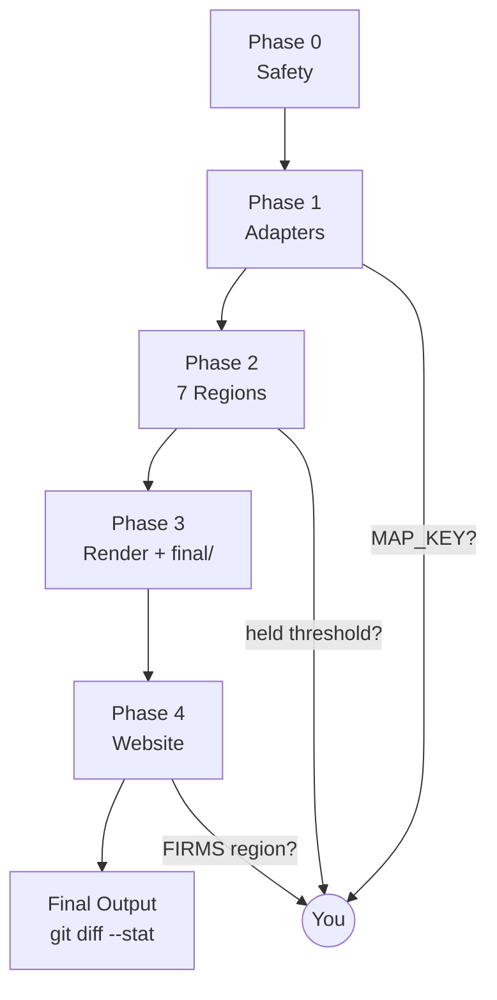

# THESOUND.EARTH — Full Code Analysis & Phased Build Plan

> **Branch:** `feature-master` | **Engine:** AetherWaves | **Last analysed:** 2026-11-15

---

## 1. Project Map (What Exists Today)

```
nasa/
├── config/
│   ├── ocean_mapping_v1.json      ← normalization / sonification config
│   └── region.json                ← 7 ocean regions + equatorial_pacific fallback
├── data/
│   ├── oscar_global.nc            ← 530 MB static NetCDF (global OSCAR)
│   └── raw_oscar/
│       ├── feat.py                ← region mask helpers (lon_mask, region_features)
│       ├── download.py            ← earthaccess downloader – deletes after use
│       ├── oscar_2021_daily.json  ← Gulf Stream daily JSON (legacy path)
│       └── regions/<id>/         ← (DOES NOT EXIST YET – Phase 2 creates it)
├── docs/                          ← Music_spec.md lives here — DO NOT EDIT
├── pipeline/
│   ├── demo_mix.py                ← GATE script (--month, --no-play)
│   ├── demo_rhythm.py
│   ├── print_melody_table.py
│   └── prove_data_link.py
├── scripts/
│   └── extract_region.py
├── src/aetherwaves/
│   ├── rhythm.py    ← FROZEN – DrumEvent, speed_to_tier, generate_drum_events
│   ├── harmony.py   ← FROZEN – chord tables, TONIC_NAMES, generate_harmony
│   ├── melody.py    ← FROZEN – MelodyEvent, generate_melody, GM programs
│   ├── dynamics.py  ← FROZEN – velocity scale, crash/riser events
│   ├── blocks.py    ← group_days_into_blocks (7-day, sector, circular mean)
│   ├── pipeline.py  ← run_pipeline (nc → wav + audit JSON)
│   ├── server.py    ← FastAPI (19 KB): globe API, SVS search, OSCAR daily
│   ├── svs.py       ← NASA SVS search, frame analysis, sonification
│   ├── synthesizer.py  ← FluidSynth render
│   ├── normalizer.py, feature_extractor.py, quality_control.py …
│   └── __init__.py
├── tests/           ← 8 test files (NEVER DELETE)
├── web/
│   ├── index.html   ← 85 KB – globe UI, evidence panel, SVS search
│   ├── flow.worker.js
│   ├── credits.html (empty)
│   └── tracks/      ← 2023.mp3, 2024.mp3, 2025.mp3, 2026-01.mp3 …
├── soundfonts/      ← FluidR3_GM (required)
├── requirements.txt
└── pyproject.toml
```

---

## 2. Frozen / Protected Files

> [!CAUTION]
> **Never modify** these files. If a task seems to require it, STOP and report the conflict.

| File | Why frozen |
|------|-----------|
| `docs/Music_spec.md` | Source-of-truth spec |
| `src/aetherwaves/rhythm.py` | Music rules |
| `src/aetherwaves/harmony.py` | Music rules |
| `src/aetherwaves/melody.py` | Music rules |
| `src/aetherwaves/dynamics.py` | Music rules |
| `pipeline/demo_mix.py` | GATE script |
| `pipeline/demo_rhythm.py` | GATE script |
| `pipeline/print_melody_table.py` | GATE script |
| `pipeline/prove_data_link.py` | GATE script |
| `tests/` | Test suite |
| `docs/` | Documentation |
| `config/` | Config dir |

---

## 3. Global Rules Checklist (enforced every phase)

- [ ] Missing data → REST (never zero). `None` in JSON = silent bar.
- [ ] All randomness seeded. `seed = sha256("<region>:<year>")` or equivalent.
- [ ] FluidSynth + FluidR3_GM only. No other synthesiser.
- [ ] No CC11 ramps in any MIDI output.
- [ ] "derived from satellite data" / "every note is computed from the data by rules we chose" (banned words list in §5).
- [ ] Do not start next phase until its GATE output is pasted.
- [ ] Do not auto-tune `hold_threshold`. Report and wait for config override.

---

## 4. Code Gaps Found in Existing Source

| Area | Gap | Phase that fixes it |
|------|-----|---------------------|
| `src/aetherwaves/adapters/` | Does not exist | Phase 1 |
| `config/regions.json` | Only `region.json` exists; `regions.json` path expected by `feat.py` | Phase 2 |
| `data/raw_oscar/regions/<id>/` | No per-region output dirs | Phase 2 |
| `final/` layout | Does not exist | Phase 3 |
| `server.py` serving `final/index.json` | Not wired | Phase 4 |
| SVS pre-build script `scripts/preprocess_svs.py` | Does not exist | Phase 4 |
| Bar-slider sync JS | Partial (tracks exist, sync logic missing) | Phase 4 |
| Nearest-region great-circle logic | Not in JS | Phase 4 |

---

## 5. Banned Words / Required Phrases

| ❌ Banned | ✅ Use instead |
|-----------|---------------|
| "100%" | — |
| "film-level" | — |
| "advanced tuning" | — |
| "guarantee" | — |
| "live" | — |
| "measured by satellites" | "derived from satellite data" |
| (any fact claim) | "every note is computed from the data by rules we chose" |

---

## 6. Phase-by-Phase Plan

---

### PHASE 0 — Safety Baseline
**Goal:** Prove the repo is clean and the pipeline runs.

```
flowchart TD
    A[git checkout feature-master] --> B[git status]
    B --> C{pipeline/ scripts all present?}
    C -- missing --> D[git restore pipeline/<script>]
    C -- OK --> E[pytest tests/]
    D --> E
    E --> F{GATE: pytest green?}
    F -- fail --> G[fix failing tests first]
    F -- pass --> H[python pipeline/demo_mix.py --month 2025-01 --no-play]
    H --> I{GATE: output printed?}
    I -- pass --> J[✅ Phase 0 done – commit]
```

**Files touched:** none (read-only checks + git restore if needed)

**GATE output needed from you:**
```
pytest output (all lines)
---
python pipeline/demo_mix.py --month 2025-01 --no-play  (full stdout)
```

---

### PHASE 1 — General Engine Adapters
**Goal:** `src/aetherwaves/adapters/` with 5 adapters, all deterministic.

#### New files
```
src/aetherwaves/adapters/
    __init__.py
    base.py        ← AdapterBase ABC: source_fields, hold_threshold, bar_unit
    oscar.py       ← wraps existing blocks.py output; identical to old path
    video.py       ← ffmpeg fps=1 gray rawvideo → numpy; Farneback optical flow
    fires.py       ← NASA FIRMS daily FRP for a bbox + year (MAP_KEY env)
    canopy.py      ← GEDI SVS-4950 static global map; spatial transect 5°lat steps
```

#### Key design constraints per adapter

| Adapter | `bar_unit` | `intensity` | `direction` | Missing = |
|---------|-----------|-------------|-------------|-----------|
| oscar | "7-day block" | `speed_p95` | `ageo_angle_deg` | `None` |
| video | "frame group" | mean Farneback magnitude | mean flow angle | `None` (black frame) |
| fires | "day" | FRP count or total FRP | stated in `source_fields` | `None` |
| canopy | "transect step" | mean GEDI height | sign of gradient | `None` |

**Cache rule (video.py):** `output/svs_features/<id>.json` keyed by video etag + adapter version.  
**Hardware decode:** optional `-hwaccel` flag read from config, not hardcoded.

#### Tests required
- `oscar` adapter output byte-identical to existing `group_days_into_blocks` path
- each adapter is deterministic (call twice → same result)
- `None` row produces a silent (rest) bar in the pipeline
- two different inputs → different bar data

**GATE:** `pytest` green + one sample row printed per adapter with `source_fields`.

> [!IMPORTANT]
> `fires.py` reads `MAP_KEY` from environment. **Ask the user for the env var name only** — never hardcode or log it.

---

### PHASE 2 — Seven Ocean Regions (2025 primary, 2024 behind flag)

#### Config changes
- Rename / create `config/regions.json` (the name `feat.py` already imports).  
  Current `config/region.json` becomes the template — values match spec exactly.

#### Longitude wrap rule
```python
# lon_mask already in feat.py — do not change the logic, just reuse it
def lon_mask(lon, a, b):
    lon, a, b = lon % 360, a % 360, b % 360
    return (lon >= a) & (lon <= b) if a <= b else (lon >= a) | (lon <= b)
```
Nordic Seas `[-15, 20]` → wraps 0/360 ✓

#### Output layout
```
data/raw_oscar/
    oscar_2025_daily.json          ← Gulf Stream (legacy path, unchanged)
    regions/
        kuroshio/oscar_2025_daily.json
        east_australian/oscar_2025_daily.json
        brazil_malvinas/oscar_2025_daily.json
        arabian_sea/oscar_2025_daily.json
        drake_acc/oscar_2025_daily.json
        nordic_seas/oscar_2025_daily.json
        equatorial_pacific/oscar_2025_daily.json  (only if arctic fallback fires)
```

#### Decision rules (automated checks, manual overrides)
```
if nordic_seas None-day% > 50%:
    set enabled=false in regions.json
    enable equatorial_pacific
    STOP and report to user

if any region held-block% > 40%:
    STOP and report — do NOT change hold_threshold
    wait for config override key approved by user
```

#### Per-region stats table (print before any music)
| Region | Valid days | % None days | P5 | P95 | Mean speed_p95 | % blocks held |
|--------|-----------|------------|-----|-----|----------------|---------------|
| _(computed)_ | | | | | | |

#### Tests
- wrap-box returns cells on both sides of 0
- config load fails loudly on duplicate id or bad lat/lon range
- normalization differs between two regions
- all existing tests pass

**GATE:** per-region table + `pytest` green.

---

### PHASE 3 — Render & Export (`final/`)

> [!IMPORTANT]
> **DO NOT RENDER YET.** Phase 3 rendering requires explicit user confirmation before executing synthesis and export.

#### Complete Multi-Domain Track Catalog

| Domain | Tracks | Bar Count & Unit | Dataset & Provenance | Target Output |
|--------|--------|------------------|----------------------|---------------|
| **Ocean** (7 tracks) | `gulf_stream`<br>`kuroshio`<br>`east_australian`<br>`brazil_malvinas`<br>`arabian_sea`<br>`drake_acc`<br>`nordic_seas` | 52 bars<br>(7-day blocks) | NASA / OSCAR surface ocean currents (2025 daily satellite data). Speed P95 + geostrophic / ageostrophic vector decomposition. | `final/2025/ocean/<region>/track.opus`<br>`meta.json` |
| **Fires** (8 tracks) | `amazon`<br>`congo`<br>`se_asia`<br>`australia`<br>`w_north_america`<br>`siberia`<br>`india`<br>`europe` | 52 bars<br>(7-day blocks) | NASA FIRMS VIIRS SNPP 375m active fire detections (2025). Daily detection counts + mean FRP. Cached locally. | `final/2025/fires/<region>/track.opus`<br>`meta.json` |
| **Canopy** (7 tracks) | `amazon` (-60.0°)<br>`congo` (20.0°)<br>`se_asia` (100.0°)<br>`australia` (135.0°)<br>`w_north_america` (-115.0°)<br>`india` (78.0°)<br>`europe` (15.0°)<br>*(siberia excluded: > 51.6°)* | 35 bars<br>(5° latitude steps) | RH98 canopy top height, 0.5 degree average, model-estimated from GEDI L1B waveforms (April-July 2019 composite; Lang et al. 2022, DOI: 10.5281/zenodo.5704852). Bounded to ISS orbital coverage ±51.6° with strict land mask along single nearest 0.5° meridian column. | `final/canopy/<region>/track.opus`<br>`meta.json` |

#### Render Pipeline Execution Flow
```
For each domain and track:
  1. Load adapter:
     - Ocean: OscarAdapter(region_id, year=2025)
     - Fires: FIRMSAdapter(region_id, year=2025, cached_csvs)
     - Canopy: CanopyAdapter(meridian_lon=region["canopy_meridian"])
  2. Compute row series (speed_p95, ageo_u, ageo_v, ageo_angle_deg, magnitude)
  3. Seed RNG deterministically: seed = sha256("<domain>:<region_id>:<year_or_step>")
  4. Generate arrangement:
     - Harmony: tonal mapping, chord changes, hold threshold (0.013)
     - Rhythm: speed-to-drum tier mapping, kick/snare patterns
     - Melody: pitch mapping & lead instruments
     - Dynamics: velocity curves & accents
  5. Synthesize MIDI to WAV via FluidSynth using FluidR3_GM.sf2
  6. Compress audio: ffmpeg -c:a libopus -b:a 48k -ac 1 → track.opus
  7. Generate and validate meta.json (dataset provenance, audit_table, narrative facts)
  8. Register in final/index.json
```

#### `final/` Layout
```
final/
    index.json                           ← manifest of all 22 tracks
    2025/
        ocean/
            gulf_stream/ (track.opus, meta.json)
            kuroshio/ (track.opus, meta.json)
            east_australian/ (track.opus, meta.json)
            brazil_malvinas/ (track.opus, meta.json)
            arabian_sea/ (track.opus, meta.json)
            drake_acc/ (track.opus, meta.json)
            nordic_seas/ (track.opus, meta.json)
        fires/
            amazon/ (track.opus, meta.json)
            congo/ (track.opus, meta.json)
            se_asia/ (track.opus, meta.json)
            australia/ (track.opus, meta.json)
            w_north_america/ (track.opus, meta.json)
            siberia/ (track.opus, meta.json)
            india/ (track.opus, meta.json)
            europe/ (track.opus, meta.json)
    canopy/
        amazon/ (track.opus, meta.json)
        congo/ (track.opus, meta.json)
        se_asia/ (track.opus, meta.json)
        australia/ (track.opus, meta.json)
        w_north_america/ (track.opus, meta.json)
        india/ (track.opus, meta.json)
        europe/ (track.opus, meta.json)
```

#### `meta.json` schema
```json
{
  "dataset": {"name": "…", "doi": "…", "url": "…", "version": "…", "fields_used": []},
  "region": {"id": "…", "bbox": {}, "period": "2025"},
  "key": {"offset_k": 0, "tonic": "Dm"},
  "seed": "sha256 hex",
  "bars": 52,
  "bar_unit": "7-day block",
  "hold_threshold": 0.013,
  "chord_changes": [],
  "drum_tier_counts": {"low": 0, "medium": 0, "high": 0},
  "audit_table": [],
  "section_captions": [],
  "source_fields": {},
  "honest_limits": "…",
  "narrative": {"text": "…", "facts_used": [0, 3, 7]},
  "checksum": "sha256 of track.opus"
}
```

#### Narrative template rule
> Every sentence MUST reference at least one `audit_table` row index in `facts_used`.  
> No invented facts. No outside knowledge.  
> Example: *"Bars 24–28 (late June): speed was in the year's top 5%, so a crash cymbal fires."*

#### Cleanup (after final/ is verified)
Delete only these files:
- `output/mix_combined_2026*`
- `output/mix_drums.mid`
- `output/mix_harmony.mid`
- `output/aetherwaves_visual.png`
- `tmp/*`

#### Tests
- same region+year → byte-identical `meta.json`
- JSON schema validation
- every track in `index.json` exists on disk
- checksums match

**GATE:** `tree final/`, per-file sizes (target < 1.5 MB each), `pytest` green.

---

### PHASE 4 — Website Updates

> [!NOTE]
> Only add and fix. Do NOT remove existing UI, globe, styles, or SVS search.

#### 4.1 Globe click → nearest region
```js
// Great-circle distance to each bbox centre
// Ocean click → nearest ocean region
// Land click → nearest land track (FIRMS or GEDI transect)
// Show: "Playing: <region> (<km> km from your click)"
// Remove "No soundscape for this region" message entirely
```

#### 4.2 Slider ↔ playback sync
```
audio.timeupdate → bar = floor(t / (240/72))
                 → day = bar * days_per_bar
                 → set slider value, date label, highlighted audit row, UV cursor
Dragging slider  → seek audio (isDragging flag prevents feedback loop)
```

#### 4.3 Track loading from `final/index.json`
```
TRACK_BASE_URL = "/final"   (config value, default local; later Supabase URL)
Lazy load:
  page load → fetch index.json
  region click → fetch track.opus
  evidence panel open → fetch meta.json
Show loading state + failure message on error
```

#### 4.4 Right panels
- Mini map zooms to selected region bbox
- UV graph plots that region's `oscar_<year>_daily.json`

#### 4.5 Evidence panel (meta.json)
Show: narrative, source_fields, honest_limits, data sources with URLs, AI use & credits.  
`honest_limits` text must include: built regions list, 2025 data, "land is a spatial transect, not a year".

#### 4.6 SVS Pair tracks
| SVS id | Handler | Pre-build script |
|--------|---------|-----------------|
| 5688, 5687 | video adapter + engine | `scripts/preprocess_svs.py 5688 5687` |
| 4950 | canopy.py transect | `scripts/preprocess_svs.py 4950` |

```
If final/svs/<id>/ exists → play that track
If not → show video only + "No sound built for this visual yet"
Website NEVER extracts frames on click.
```

#### 4.7 Land tracks (needs user input before build)
- FIRMS track: **Ask user for region + MAP_KEY env var**
- GEDI transect: 1 track (SVS 4950 via canopy.py)

#### 4.8 Layout fixes (no content removal)
- Left panel stops above dock; panel body scrolls only
- Dark thin scrollbars
- Sticky table header
- MELODY column not clipped
- Logo moves into panel header when maximised
- Track title ellipsis + time on one line
- Mobile full-screen panel

#### 4.9 Accessibility
- `aria-label` on all interactive elements
- Visible focus rings
- Keyboard-operable region list
- Text description per track

#### Tests
- `index.json` served by TestClient
- Unknown track → JSON 404
- Nearest-region function: 6 known points (1 land, 1 exactly inside box)
- Bar-to-day mapping

**GATE:** `pytest` green + screenshots at 1280×800, 1920×1080, 390×844 (normal + maximised) + cold-cache timings.

---

## 7. Open Decisions Requiring Your Input

| # | Decision | Blocking which phase |
|---|---------|----------------------|
| 1 | **Arctic fallback**: if Nordic Seas >50% None days, enable equatorial_pacific? (auto-decided by rule, but report to you first) | Phase 2 |
| 2 | **Held-block thresholds**: if any region >40% held blocks, what override value to use? | Phase 2 |
| 3 | **FIRMS region**: which lat/lon box for the land track? | Phase 4 |
| 4 | **MAP_KEY env var name**: what env var holds your FIRMS API key? | Phase 1 & 4 |
| 5 | **SVS hardware decode**: is `-hwaccel` available on your machine? | Phase 1 |
| 6 | **TRACK_BASE_URL**: will it stay `/final` (local) or move to Supabase? | Phase 4 |

---

## 8. Dependency Graph



---

## 9. What Will NOT Be Built (Explicitly Out of Scope)

- Voice navigation
- Spatial audio
- 2024 data (available behind `--year 2024` flag only, not default)
- Any FM synthesiser or home-made synthesis
- CC11 ramps
- Automated threshold tuning

---

## 10. Commit Cadence

| Commit message | When |
|----------------|------|
| `chore: phase-0 safety baseline` | After Phase 0 GATE passes |
| `feat: phase-1 adapters` | After Phase 1 GATE passes |
| `feat: phase-2 seven-regions` | After Phase 2 GATE passes |
| `feat: phase-3 render-export` | After Phase 3 GATE passes |
| `feat: phase-4 website` | After Phase 4 GATE passes |
