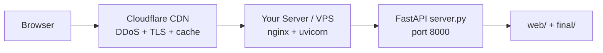

# Deploying THESOUND.EARTH — GoDaddy → Cloudflare → Production

> Connect your GoDaddy domain to Cloudflare and serve the FastAPI + static site.

---

## Overview



---

## Step 1 — Add Your Domain to Cloudflare

1. Go to [dash.cloudflare.com](https://dash.cloudflare.com) → **Add a Site**
2. Enter your GoDaddy domain (e.g. `thesound.earth`) → **Continue**
3. Choose the **Free** plan → **Continue**
4. Cloudflare scans your existing DNS records. Review them.
5. Note the **two Cloudflare nameservers** shown, e.g.:
   ```
   alice.ns.cloudflare.com
   bob.ns.cloudflare.com
   ```

---

## Step 2 — Point GoDaddy Nameservers to Cloudflare

1. Log in to [GoDaddy](https://dcc.godaddy.com) → **My Products** → your domain → **DNS**
2. Click **Nameservers** → **Change** → **Enter my own nameservers**
3. Enter the two Cloudflare nameservers from Step 1
4. Save. DNS propagation takes **10 minutes to 48 hours**.

> [!NOTE]
> While waiting, complete Steps 3–6 on your server so it is ready.

---

## Step 3 — Set Up Cloudflare DNS Records

In Cloudflare dashboard → **DNS → Records**:

| Type | Name | Content | Proxied |
|------|------|---------|---------|
| A | `@` | `<YOUR_SERVER_IP>` | ✅ Yes (orange cloud) |
| A | `www` | `<YOUR_SERVER_IP>` | ✅ Yes |
| CNAME | `api` | `thesound.earth` | ✅ Yes (optional) |

> [!IMPORTANT]
> Keep the orange cloud (**Proxied**) ON. This routes traffic through Cloudflare's CDN, hides your server IP, and enables free TLS.

---

## Step 4 — Enable Cloudflare TLS

**Dashboard → SSL/TLS → Overview:**
- Set mode to **Full (strict)**

**Dashboard → SSL/TLS → Edge Certificates:**
- Enable **Always Use HTTPS** ✅
- Enable **Automatic HTTPS Rewrites** ✅
- Set **Minimum TLS Version** to `TLS 1.2`

**Dashboard → Caching → Configuration:**
- **Browser Cache TTL**: `4 hours`
- **Cache Level**: `Standard`

---

## Step 5 — Server Setup (Linux VPS / Ubuntu)

### 5a. Install system dependencies

```bash
sudo apt update && sudo apt install -y \
    python3.12 python3.12-venv python3-pip \
    ffmpeg fluidsynth nginx certbot python3-certbot-nginx \
    git
```

### 5b. Clone repo and install

```bash
cd /srv
git clone <your-repo-url> thesound
cd thesound
git checkout feature-master

python3.12 -m venv venv
source venv/bin/activate
pip install -r requirements.txt
pip install -e .
```

### 5c. Environment variables

```bash
# /srv/thesound/.env
MAP_KEY=<your_FIRMS_key>          # Only needed for fires adapter
TRACK_BASE_URL=/final             # Or your Supabase URL later
```

Load in systemd service (see §5d).

### 5d. Create systemd service

```ini
# /etc/systemd/system/thesound.service
[Unit]
Description=THESOUND.EARTH FastAPI
After=network.target

[Service]
User=www-data
WorkingDirectory=/srv/thesound
EnvironmentFile=/srv/thesound/.env
ExecStart=/srv/thesound/venv/bin/uvicorn aetherwaves.server:app \
    --host 127.0.0.1 --port 8000 --workers 2
Restart=on-failure
RestartSec=5

[Install]
WantedBy=multi-user.target
```

```bash
sudo systemctl daemon-reload
sudo systemctl enable --now thesound
sudo systemctl status thesound
```

---

## Step 6 — nginx Reverse Proxy

```nginx
# /etc/nginx/sites-available/thesound
server {
    listen 80;
    server_name thesound.earth www.thesound.earth;
    return 301 https://$host$request_uri;
}

server {
    listen 443 ssl http2;
    server_name thesound.earth www.thesound.earth;

    # Cloudflare Origin cert (or certbot cert)
    ssl_certificate     /etc/ssl/cloudflare/thesound.earth.pem;
    ssl_certificate_key /etc/ssl/cloudflare/thesound.earth.key;

    # Static files served directly by nginx (fast, no Python)
    root /srv/thesound;

    location /final/ {
        alias /srv/thesound/final/;
        add_header Cache-Control "public, max-age=86400";
        gzip_static on;
    }

    location /web/ {
        alias /srv/thesound/web/;
        add_header Cache-Control "public, max-age=3600";
    }

    location / {
        # Everything else → FastAPI
        proxy_pass         http://127.0.0.1:8000;
        proxy_set_header   Host $host;
        proxy_set_header   X-Real-IP $remote_addr;
        proxy_set_header   X-Forwarded-For $proxy_add_x_forwarded_for;
        proxy_set_header   X-Forwarded-Proto $scheme;
        proxy_read_timeout 120s;
    }
}
```

```bash
sudo ln -s /etc/nginx/sites-available/thesound /etc/nginx/sites-enabled/
sudo nginx -t
sudo systemctl reload nginx
```

---

## Step 7 — Cloudflare Origin Certificate (recommended over certbot)

Cloudflare → **SSL/TLS → Origin Server → Create Certificate**
- Choose RSA 2048
- Hosts: `thesound.earth`, `*.thesound.earth`
- Validity: 15 years

Download both files:
```bash
sudo mkdir /etc/ssl/cloudflare
# paste pem → /etc/ssl/cloudflare/thesound.earth.pem
# paste key → /etc/ssl/cloudflare/thesound.earth.key
sudo chmod 600 /etc/ssl/cloudflare/thesound.earth.key
```

---

## Step 8 — Cloudflare Cache Rules for `final/`

**Dashboard → Caching → Cache Rules → Create Rule:**

| Setting | Value |
|---------|-------|
| Name | `Cache final/ tracks` |
| When | URL path starts with `/final/` |
| Cache | Eligible for cache |
| Edge TTL | 1 day |
| Browser TTL | 4 hours |

Add a second rule for `index.json`:

| Setting | Value |
|---------|-------|
| Name | `Short-cache index.json` |
| When | URL ends with `index.json` |
| Edge TTL | 5 minutes |
| Browser TTL | 0 (no browser cache) |

---

## Step 9 — Cloudflare Page Rules / Security

**Dashboard → Security → WAF:**
- Enable **Bot Fight Mode**

**Dashboard → Network:**
- Enable **HTTP/2** ✅
- Enable **HTTP/3 (QUIC)** ✅
- Enable **0-RTT Connection Resumption** ✅

**Dashboard → Speed → Optimization:**
- Enable **Auto Minify** (HTML, CSS, JS) ✅
- Enable **Brotli** ✅

---

## Step 10 — Verify Everything

```bash
# 1. API health
curl -s https://thesound.earth/api/oscar_daily/2025 | python3 -m json.tool | head -20

# 2. Static track
curl -I https://thesound.earth/final/index.json
# Expect: CF-Cache-Status: HIT (after first request)

# 3. TLS grade
# Visit: https://www.ssllabs.com/ssltest/analyze.html?d=thesound.earth
# Target: A or A+

# 4. Speed
curl -o /dev/null -s -w "TTFB: %{time_starttransfer}s\n" https://thesound.earth
# Target: < 400 ms
```

---

## Step 11 — Supabase (Optional — future `TRACK_BASE_URL`)

If you later move `final/` to Supabase Storage:

1. Create a Supabase project → Storage → New bucket `tracks` (public)
2. Upload `final/` contents via Supabase CLI:
   ```bash
   supabase storage cp -r final/ ss:///tracks/
   ```
3. Set in `.env`:
   ```
   TRACK_BASE_URL=https://<project>.supabase.co/storage/v1/object/public/tracks
   ```
4. No server change needed — the JS reads `TRACK_BASE_URL` from `final/index.json`.

---

## Checklist Summary

- [ ] Cloudflare account created, domain added
- [ ] GoDaddy nameservers updated to Cloudflare's
- [ ] DNS A records set (proxied)
- [ ] SSL/TLS → Full (strict) + Always HTTPS
- [ ] Server: Python 3.12, ffmpeg, fluidsynth, nginx installed
- [ ] `.env` with MAP_KEY and TRACK_BASE_URL
- [ ] systemd service running (`systemctl status thesound`)
- [ ] nginx config in place and tested (`nginx -t`)
- [ ] Cloudflare Origin cert installed
- [ ] Cache rules for `/final/` and `index.json`
- [ ] `curl https://thesound.earth/final/index.json` returns 200
- [ ] SSL Labs grade A or A+
